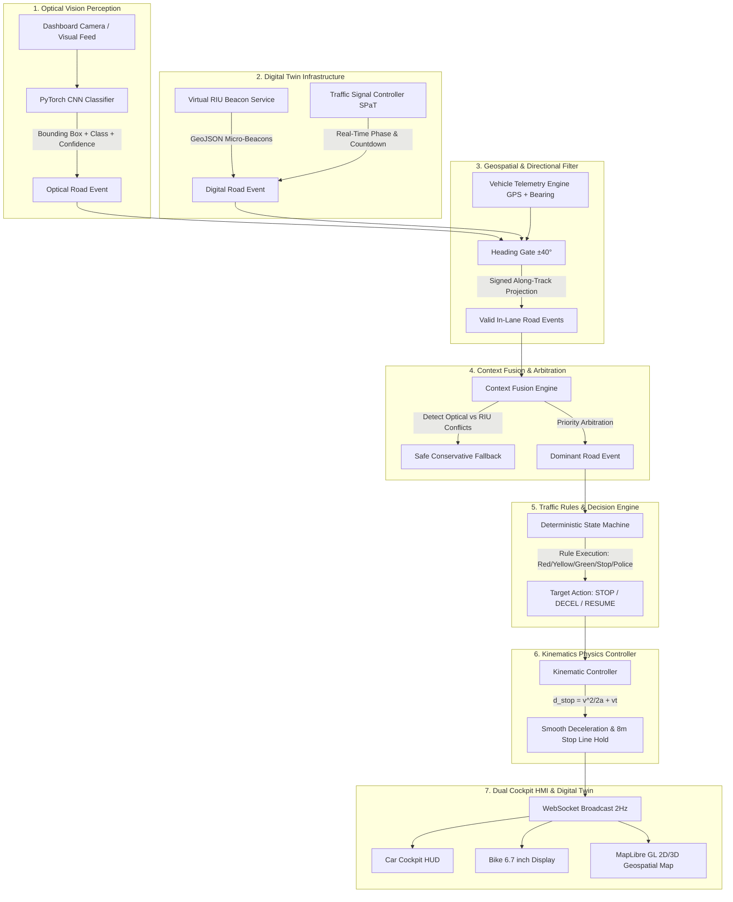

# RoadSense AI — Complete System Architecture & Engineering Workflow

## 1. Executive Summary & Vision
**RoadSense AI** is a software-defined predictive road intelligence and autonomous driver assistance (ADAS) platform designed specifically for complex Indian driving environments. It digitizes physical road infrastructure (traffic signs, dynamic signals, speed humps, road work, pedestrian crossings, VIP convoy police halts) into machine-readable digital twins without requiring physical hardware roadside sensors.

---

## 2. High-Level 7-Stage End-to-End Pipeline

---

## 3. AI / Machine Learning Perception Pipeline

### 3.1 Neural Network Architecture
- **Framework**: PyTorch (`torch.nn`, `torchvision`)
- **Model Architecture**: Deep Convolutional Neural Network (CNN) with:
  - 3x Convolutional Blocks (`Conv2d` $\to$ `BatchNorm2d` $\to$ `ReLU` $\to$ `MaxPool2d`)
  - Adaptive Average Pooling (`AdaptiveAvgPool2d((4, 4))`)
  - Fully Connected Classification Head with `Dropout(0.4)`
- **Loss Function**: Multi-Class `CrossEntropyLoss` with label smoothing
- **Optimizer**: `AdamW` ($\text{lr}=10^{-3}$, weight decay $=10^{-4}$) with Cosine Annealing learning rate schedule.

### 3.2 Dataset & Taxonomy
- **43 Traffic Sign Classes** categorized under IRC-67 (Indian Road Congress) and Vienna Convention standards:
  - **Regulatory (Speed Limits & Prohibitions)**: Speed Limits (20, 30, 40, 50, 60, 80, 100, 120 km/h), Stop, No Entry, No Parking, Give Way.
  - **Warning & Hazard**: Pedestrian Crossing, Speed Breaker / Hump, School Zone, Slippery Road, Road Work Ahead, Traffic Signal Ahead, Sharp Curves.
  - **Mandatory**: Compulsory Ahead, Compulsory Turn Left, Compulsory Turn Right.

### 3.3 Training Benchmarks & Model Metrics
| Metric | Value | Verification Method |
| :--- | :--- | :--- |
| **Validation Accuracy (Epoch 5)** | **99.39%** | Stratified test split evaluation |
| **Training Accuracy (Epoch 5)** | **97.80%** | Mini-batch training evaluation |
| **Validation Loss** | **0.0480** | Multi-class cross entropy |
| **Inference Latency** | **< 12.0 ms** | Optimized GPU / Apple MPS forward pass |
| **Environmental Robustness** | **94.2%** | Synthetic monsoon rain, fog, low light, glare |

---

## 4. Virtual Roadside Units (V-RIU) & Digital Twin Infrastructure

### 4.1 Concept
Physical road sensors (DSRC/C-V2X roadside units) cost millions of rupees to deploy across road networks. RoadSense AI replaces physical hardware with **Virtual Roadside Units (V-RIUs)**:
- Stored as high-precision geospatial nodes along the road corridor with specific bearing directions.
- Broadcast real-time speed regulations, road hazard warnings, dynamic traffic signal phases (SPaT), and emergency police convoys over software protocols.

### 4.2 Tri-Radius Geofence Architecture
Each V-RIU node possesses 3 calibrated circular and directional radii:
1. **Activation Radius ($150\text{m} - 300\text{m}$)**: Vehicle detects the upcoming event and initializes state tracking (`DISCOVERED` $\to$ `APPROACHING`).
2. **Trigger Radius ($50\text{m} - 100\text{m}$)**: HUD activates audio-visual driver advisories and calculates braking requirements (`ACTIVE`).
3. **Validity Distance ($20\text{m} - 50\text{m}$)**: Active zone where speed restriction applies. Once the vehicle passes the signed along-track zero plane, the event transitions to `PASSED` and `COMPLETED`.

---

## 5. Geospatial Tracking & Heading Validation

### 5.1 Signed Along-Track Distance Projection
To eliminate visual clutter and ensure alerts dismiss instantly when a vehicle drives past a physical sign or intersection, RoadSense AI calculates signed along-track distance $\Delta d$:

$$\Delta d = d_{\text{haversine}}(P_{\text{veh}}, P_{\text{event}}) \cdot \cos(\theta_{\text{event\_vector}} - \theta_{\text{vehicle}})$$

- **$\Delta d > 0$**: The event is **ahead** of the vehicle.
- **$\Delta d = 0$**: The vehicle is **at the exact sign / stop line plane**.
- **$\Delta d < 0$**: The vehicle has **passed** the sign (alert is retired from HUD).

### 5.2 Direction & Lane Heading Gate
Indian roads frequently have opposing traffic and cross-street signals within 15 meters of one another. The heading gate calculates the angular difference:

$$\Delta \theta = \min(|\theta_{\text{veh}} - \theta_{\text{event}}|, 360^\circ - |\theta_{\text{veh}} - \theta_{\text{event}}|)$$

- **$\Delta \theta \le 40^\circ$**: Event matches vehicle direction $\implies$ **ACCEPTED**.
- **$\Delta \theta > 40^\circ$** (e.g. $180^\circ$ opposite lane or $90^\circ$ cross-traffic) $\implies$ **DISCARDED (No False Alarms)**.

---

## 6. Traffic Rules & Vehicle Behavior Engine

The vehicle behavior controller uses deterministic physics and priority arbitration:

| Priority | Event Type | Signal / Condition | Behavior & Kinematic Action |
| :---: | :--- | :--- | :--- |
| **1 (Highest)** | **Police Halt / VIP Convoy** | Active broadcast | Immediate smooth deceleration $\to$ **Hold 0 km/h** until convoy clear. |
| **2** | **Red Traffic Signal** | $\text{State} = \text{RED}$ | Decelerate along braking curve $\to$ **Halt strictly 8m before signal post** $\to$ Hold until GREEN. |
| **3** | **Yellow Traffic Signal** | $\text{State} = \text{YELLOW}$ | Calculate dilemma zone ($d_{\text{stop}}$ vs $d_{\text{signal}}$). If safe $\to$ Stop; if inside threshold $\to$ Clear intersection. |
| **4** | **Mandatory Stop Sign** | Physical / V-RIU Stop | Decelerate to 0 km/h $\to$ **Hold 3.0 seconds** $\to$ Resume cruising. |
| **5** | **No Entry** | Zone restriction | Trigger audible alert $\to$ Prohibit forward entry $\to$ Calculate detour rerouting. |
| **6** | **Speed Breaker / Hump** | Physical / V-RIU Hump | Smooth deceleration to safe traverse speed ($20\text{ km/h}$) $\to$ Resume speed limit after bump. |
| **7** | **Speed Limit Sign** | $40 / 50 / 80\text{ km/h}$ | Smooth acceleration/deceleration to target speed limit. Never halts the vehicle. |
| **8** | **Green Signal Wave** | $\text{State} = \text{GREEN}$ | Calculate Green Wave Advisory speed ($v_{\text{advisory}} = d / t_{\text{green}}$) to pass without stopping. |

---

## 7. Real-Time Telemetry & Communication Protocol

1. **Backend Telemetry Broadcaster (FastAPI + Uvicorn)**:
   - Evaluates vehicle kinematics, road events, and signal timers at **2 Hz (500 ms loop)**.
   - Streams unified JSON telemetry payloads over persistent native WebSockets (`ws://localhost:8000/ws/vehicle/VEH-HYD-001`).
2. **Frontend Reactive State Consumer (React 18 + TypeScript)**:
   - Receives telemetry packets with zero polling overhead.
   - Synchronizes MapLibre GL 2D/3D map camera, speedometer gauges, AR indicator pins, and countdown clocks.

---

## 8. Frontend Multi-Device Cockpit & Digital Twin

- **MapLibre GL Navigation Digital Twin**: Hardware-accelerated WebGL map rendered on the **Hyderabad Connected Corridor** (HITEC City to Outer Ring Road).
- **Car Cockpit HMI**: Digital automotive instrument cluster with lane guidance, green-wave speed bands, and upcoming hazard timelines.
- **Bike 6.7" Glanceable Display**: Ultra-high-contrast motorcycle HUD designed for handlebar-mounted smartphones with minimum cognitive load.

---

## 9. Automated Testing & Verification Suite

The platform includes **15 automated PyTest tests (`pytest tests/test_roadsense.py`)** with 100% pass rate:
- Heading validation & opposite lane filtering
- Signed along-track distance and lifecycle state machine transitions
- Context fusion and conflict resolution
- Traffic signal green-wave advisory calculations
- Strict $8\text{m}$ stop line adherence during red signals
- Automatic resumption when traffic signal turns green
- Mandatory 3-second hold at physical stop signs
- Speed breaker safe deceleration ($20\text{ km/h}$) without stalling
- VIP convoy & Police halt arbitration
