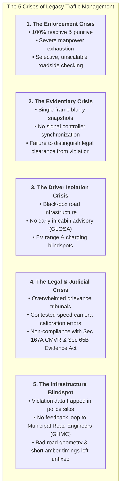
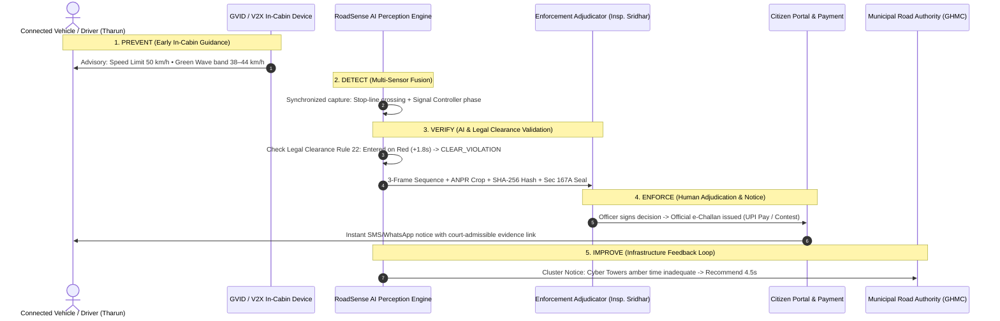
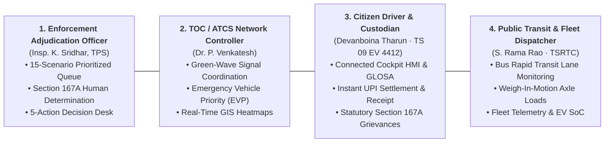

# RoadSense AI — Master Problem Statement & Ecosystem Architecture

> **Document Type:** Master System Problem Statement & Product Architecture Charter  
> **Platform Name:** RoadSense AI  
> **Edition:** 2026 Enterprise & Government Edition (Updated Full Version)  
> **Target Deployment:** Metropolitan Intelligent Transportation Systems (ITMS) & Smart Mobility Infrastructure (Hyderabad/Cyberabad Pilot Baseline)

---

## 1. Executive Summary & Core Problem Statement

Modern urban traffic management systems suffer from a fundamental, systemic flaw: **they are entirely reactive, post-facto, punitive, and fragmented.**

Today, millions of vehicles travel across complex urban road networks where traffic enforcement relies on intermittent roadside cameras or physical police presence. Drivers receive no early warning about dynamic speed limit changes, active signal phases, or upcoming road hazards. When a violation is captured, it is frequently based on a single ambiguous photograph that lacks signal controller synchronization, vehicle trajectory context, or cryptographic tamper protection. This results in wrongful citations, contested court disputes, and citizen distrust. Most critically, **issuing a monetary fine weeks after an infraction does nothing to prevent the accident that could have occurred at the moment of the violation.**

### The Core Problem Statement in One Sentence:
> *"How can a government traffic authority transition from an adversarial, manpower-heavy, post-facto punitive enforcement model to a continuous, connected, preventive road-safety and legally accountable compliance ecosystem that prevents accidents in real time, automates indisputable evidentiary adjudication under Section 167A of the Central Motor Vehicles Rules (CMVR), and directly translates violation hotspots into long-term infrastructure improvements?"*

---

## 2. The Multi-Dimensional Breakdown of the Crisis



### Crisis A: The Enforcement & Manpower Bottleneck
- Traffic police departments are critically understaffed. In mega-cities like Hyderabad, Bengaluru, and Delhi, traffic police personnel must manually manage congested intersections, conduct physical vehicle intercept inspections, and review hundreds of thousands of low-confidence camera hits.
- This creates enforcement blindspots: violations on secondary corridors go completely unmonitored, while major intersections suffer from officer fatigue and arbitrary enforcement.

### Crisis B: The Evidentiary & Legal Defensibility Crisis
- Under **Rule 22 of the Motor Vehicles (Driving) Regulations, 2017**, a vehicle that enters an intersection on green or amber and traverses during red is performing **legal clearance of the junction**. Legacy automated camera systems cannot distinguish between a vehicle clearing the junction and an intentional red-light runner, resulting in thousands of wrongful challans.
- Furthermore, under **Section 167A of the Central Motor Vehicles Rules (CMVR)** (mandated by the Motor Vehicles Amendment Act, 2019), electronic enforcement must be supported by certified electronic records containing multi-angle visual sequences, time synchronization, and human officer review. Legacy systems issue automatic challans without digital audit trails or cryptographic SHA-256 evidence seals, leading to widespread legal challenges under Section 65B of the Indian Evidence Act.

### Crisis C: The Driver Isolation & Preventive Blindspot
- Vehicles today operate as isolated "blind islands." A driver entering a 30 km/h school zone or approaching a high-speed flyover curve receives no active in-cabin speed envelope guidance.
- Electric Vehicle (EV) drivers face the compound challenge of range unpredictability, missing corridor charging data, and sudden deceleration zones.
- Drivers are penalized for infractions that could have easily been avoided with 5 seconds of advance in-cabin V2X/GLOSA (Green Light Optimal Speed Advisory) intelligence.

### Crisis D: The Calibration Uncertainty & "Benefit of the Doubt" Deficit
- Speed enforcement cameras and radar devices have intrinsic measurement tolerances ($\pm 1$ to $\pm 3\text{ km/h}$). When a driver exceeds a 50 km/h limit by a fraction of a kilometer (e.g., driving at 51.2 km/h), legacy systems generate a blanket penal challan. This breeds cynicism and citizen outrage. Modern legal systems require a statutory calibration grace margin ($\pm 2.0\text{ km/h}$) to protect fair drivers while decisively penalizing reckless speeding.

### Crisis E: The Disconnected Feedback Loop (Siloed Data)
- Traffic departments log thousands of red-light violations at specific junctions every month, but that data never reaches the Municipal Corporations or Public Works Departments (e.g., GHMC, NHAI).
- If 80% of red-light violations at Cyber Towers occur within 1.5 seconds of red onset, the root cause is almost certainly an **inadequate amber clearance interval (e.g., 3.0s instead of 4.5s)** or a poorly visible stop line. Legacy systems treat this as a recurring revenue stream rather than an engineering defect to be resolved.

---

## 3. The RoadSense AI Paradigm Shift

RoadSense AI flips the legacy punitive model upside down through a closed-loop operating philosophy:

$$\mathbf{PREVENT} \longrightarrow \mathbf{DETECT} \longrightarrow \mathbf{VERIFY} \longrightarrow \mathbf{ENFORCE} \longrightarrow \mathbf{IMPROVE}$$



---

## 4. The 15 Traffic Enforcement & Safety Scenarios Solved

RoadSense AI categorizes all urban traffic challenges into **4 operational priority tiers**, applying tailored evidentiary and legal logic to each:

| Scenario Tier | Violation Category | Specific Technical & Evidentiary Problem Solved | Applicable Legal Section |
| :--- | :--- | :--- | :--- |
| **Priority 1 (Flagship Intersection Compliance)** | **1. Red-Light Jumping** | Synchronizes junction camera timestamps with ATCS signal phase controllers down to $\pm 10\text{ms}$. Distinguishes legal junction clearance (green/amber entry) from post-red stop-line breach. | Sec 184 / Sec 119 MV Act (Rule 22 MVDR) |
| | **2. Crossing Stop Line during Red** | Detects front axle crossing the painted stop line while red is active without entering the intersection grid. | Sec 177 MV Act |
| | **3. Blocking Pedestrian Zebra Crossings** | Detects stationary or encroaching vehicles occupying marked pedestrian refuges during walk phases. | Sec 177 / Sec 198 MV Act |
| | **4. Yellow Box Junction Gridlock** | Detects vehicles entering a yellow cross-hatched junction box without a clear exit, preventing cascading gridlock. | Sec 177 MV Act (IRC:67) |
| **Priority 2 (Road Compliance & Dynamics)** | **5. Wrong-Side Driving** | Vector heading validation against road segment authorized direction-of-travel; flags head-on collision risks immediately. | Sec 184 (Dangerous Driving) |
| | **6. Overspeeding (GVID + Road Limit)** | Dual-band RTK GNSS + vehicle CAN speed verified against road segment limit, applying mandatory $\pm 2.0\text{ km/h}$ calibration grace margin. | Sec 183(1) & (2) MV Act |
| | **7. Illegal Parking & Stoppage** | Detects stationary vehicles in tow-away zones, bus stop bays, and emergency corridors using sustained duration tracking (>120s). | Sec 122 / Sec 177 MV Act |
| | **8. Wrong-Lane / Dedicated Bus Lane** | Tracks vehicle lane positioning and flags unauthorized private cars driving inside dedicated BRTS / TSRTC corridors. | Sec 177 MV Act |
| | **9. Restricted-Entry / Heavy Vehicle Violations** | Monitors night-time or peak-hour heavy vehicle restrictions using ANPR classification and axle counts. | Sec 115 / Sec 194 MV Act |
| **Priority 3 (Passive & Active Safety)** | **10. No Helmet (Rider & Pillion)** | Dual-head YOLOv8 detection identifying both the operator and pillion rider without certified protective headgear. | Sec 129 / Sec 194D MV Act |
| | **11. No Seat Belt** | Front-windshield optical inspection verifying driver and co-passenger three-point seat belt compliance. | Sec 138(3) / Sec 194B MV Act |
| | **12. Handheld Mobile Phone Use** | Detects handheld mobile devices held to the ear or operated while in active motion. | Sec 184(c) MV Act |
| | **13. Failure to Yield to Emergency Vehicles** | Detects failure to clear lane upon receiving siren acoustic signature and Emergency Vehicle Priority (EVP) V2X broadcast. | Sec 194E MV Act (₹10,000 fine) |
| **Priority 4 (Specialized & Heavy Transport)** | **14. Overloaded Goods Vehicles** | Integrates roadside Weigh-In-Motion (WIM) sensors with ANPR to flag axle load and gross vehicle weight (GVW) breaches. | Sec 194(1) MV Act |
| | **15. Dangerous / Prohibited Overtaking** | Detects solid white/yellow double-line overtaking and blind-curve crossing on non-divided roads. | Sec 184 MV Act |

---

## 5. Persona & Role-Based Access Architecture

RoadSense AI rejects the simplistic "one-dashboard-fits-all" concept. It operates as a unified platform serving 4 distinct civic personas:



1. **Enforcement Adjudication Officer (Traffic Incharge):**
   - Reviews multi-frame evidence packages, examines signal controller sync charts, inspects camera calibration certificates, and executes one of five legally binding actions: *Verify*, *Request Re-Audit*, *Dismiss*, *Escalate*, or *Approve Challan*.
2. **Traffic Operations Center (TOC) Controller:**
   - Monitors live corridor traffic status, triggers automated green waves for ambulances and fire engines (Emergency Vehicle Preemption), and balances intersection wait times.
3. **Citizen Driver & Vehicle Custodian (Demonstration Persona: Tharun):**
   - Experiences preventive in-cabin speed guidance, receives instant verified notices with SHA-256 evidence links, pays via UPI, or files statutory dispute appeals under Section 167A CMVR.
4. **Public Transit & Commercial Fleet Dispatcher:**
   - Oversees bus rapid transit compliance, monitors EV battery state-of-charge across municipal charging hubs, and tracks commercial vehicle axle overloads.

---

## 6. The Tharun Demonstration Journey (Connecting All Modules)

To prove that RoadSense AI is a cohesive ecosystem rather than a disjointed collection of features, the platform incorporates an **8-Scene Interactive Demonstration Journey** featuring driver **Devanboina Tharun** in his **Tata Nexon EV Max** (`TS 09 EV 4412`):

```
Scene 1: Starting the Journey ────► Scene 2: Preventive Guidance ────► Scene 3: Signal Approach
(Connected Cockpit, GVID Online)    (Early Limit & Hazard Advisory)     (GLOSA Speed Band, Amber Phase)
                                                                                       │
                                                                                       ▼
Scene 6: Officer Adjudication ◄──── Scene 5: AI & Legal Check ◄───── Scene 4: Multi-Frame Capture
(Insp. Sridhar signs Sec 167A)      (Stop line breach verified)         (Approach, Crossing, Traversal)
       │
       ▼
Scene 7: Citizen Portal ──────────► Scene 8: Infrastructure Fix
(UPI Payment & Official Receipt)    (GHMC signal timing extended from 3.0s to 4.5s)
```

---

## 7. Legal, Technical & Statutory Compliance Standards

RoadSense AI is built strictly to satisfy Indian and international transportation and evidentiary statutes:

- **Motor Vehicles (Amendment) Act, 2019:** Sections 183 (Speeding), 184 (Dangerous Driving), 185 (Impaired Driving), 194B (Seatbelts), 194D (Helmets), 194E (Emergency Vehicles).
- **Central Motor Vehicles Rules (CMVR) — Section 167A:** Electronic monitoring and enforcement of road safety. Enforces mandatory human officer verification, high-resolution multi-frame photographic capture, and digital time synchronization.
- **Indian Evidence Act, 1872 — Section 65B:** Electronic admissibility certificate with SHA-256 cryptographic hashes for court-defensible digital evidence.
- **Indian Roads Congress (IRC) Standards:**
  - **IRC:67-2012:** Code of Practice for Road Signs.
  - **IRC:93-1985:** Guidelines for Design of Traffic Light Signals.
  - **IRC:SP:84-2019:** Manual of Specifications and Standards for Four-Laning of Highways.
- **Automotive Industry Standards (AIS):** AIS-140 Intelligent Transportation Systems (GNSS Tracking, Emergency Buttons, and Device Health Telemetry).
- **V2X Communication Protocol:** 5.9 GHz DSRC / C-V2X (SPaT - Signal Phase and Timing broadcast & MAP messages).

---

## 8. Summary of What RoadSense AI Eliminates vs. What It Delivers

| Legacy Traffic System (What is Eliminated) | RoadSense AI (What is Delivered) |
| :--- | :--- |
| **Purely punitive fine collection** weeks after the fact | **Real-time preventive in-cabin speed & signal guidance** to avert crashes |
| **Single ambiguous grainy camera snapshot** | **3-frame sequence (Approach, Crossing, Traversal) + ANPR crop** |
| **Manual police stops** causing traffic jams and safety risks | **Non-intrusive automated detection with officer review desk** |
| **Legal clearance penalized as red-light jumping** | **Mathematical state machine enforcing Rule 22 legal clearance** |
| **Zero tolerance on speed measurement errors** | **Statutory $\pm 2.0\text{ km/h}$ calibration grace margin** protecting motorists |
| **Unsigned electronic notices prone to court rejection** | **Section 167A CMVR & Section 65B certified SHA-256 digital seals** |
| **Endless court visits for contested challans** | **1-click online statutory grievance portal with evidence access** |
| **Traffic violation data trapped in police silos** | **Automated infrastructure advisory reports to Municipal Bodies (GHMC)** |
